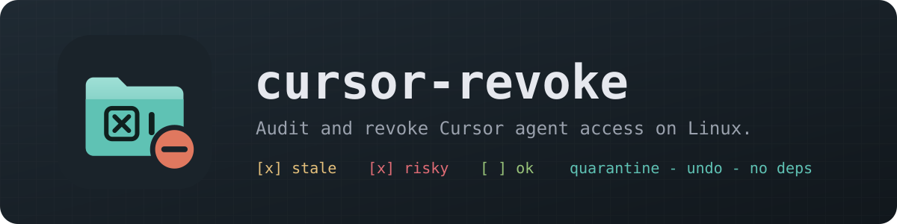
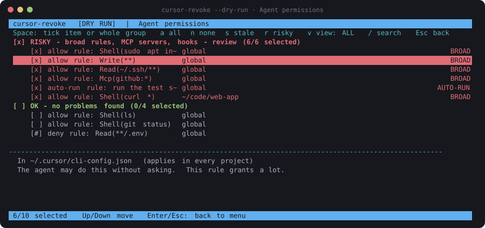
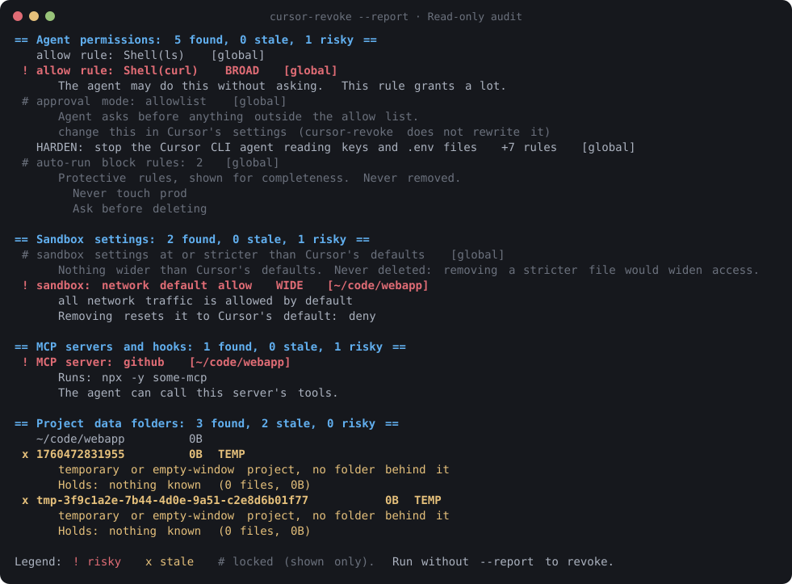
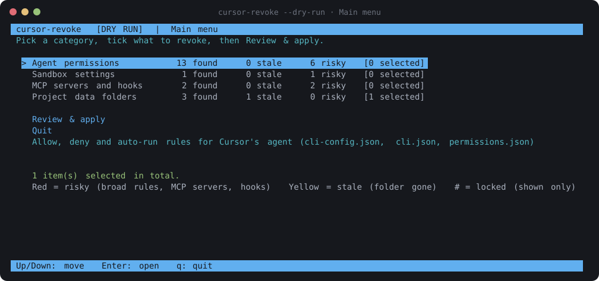

<p align="center">
  
</p>

<p align="center">
  
  
  
  
</p>

---

Cursor's agent can run shell commands, read files, reach the network and call MCP servers, and it remembers what you allowed. Over time that builds up across global and per-project files, with no single place to see it all.

**cursor-revoke** is an installer-style terminal UI in reverse. Instead of choosing what to install, you see every grant Cursor's agent has on your machine, grouped into **STALE**, **RISKY** and **OK**, tick what you want gone, and apply. Nothing is deleted: removed items go to a quarantine folder, edited files are backed up first, and one command undoes a run.

<p align="center">
  
</p>

> [!IMPORTANT]
> Cursor's file formats are young and change between versions. The formats cursor-revoke reads were confirmed against a real Cursor install (October 2026), but this release has not been run on your machine. **Run `cursor-revoke --report` first** and check it against what you expect. Anything it does not recognise is shown as "unknown format, not touched".

## Features

- **Full inventory**: agent allow and deny rules, auto-run rules, approval mode, sandbox settings, MCP servers, hooks and per-project agent data folders, both global (`~/.cursor`) and per project (`<project>/.cursor`).
- **Grouped checkboxes**: STALE (project folder gone), RISKY (broad rules such as `Shell(*)` or `Write(**)`, auto-run rules, wide sandbox fields, MCP servers, hooks) and OK. Tick a whole group or one item at a time.
- **Hardening**: one tick adds `Read(...)` deny rules for `~/.ssh`, `~/.aws`, `~/.gnupg`, `.env`, `*.pem` and `*.key` to `~/.cursor/cli-config.json`. This covers the **Cursor CLI agent only**; it is not confirmed to protect the editor or the Agents Window.
- **Only narrows access**: removing narrows access, with one exception: a hook on a `before...` event (such as `beforeShellExecution`, `beforeMCPExecution` or `beforeReadFile`) may be a safety check that blocks actions, so removing it can allow what it blocked. These guard hooks say so in their details and are not ticked by `r`. Deny and block rules are never removed, and sandbox files are edited field by field, never deleted.
- **Safe by design**: dry-run mode, a review screen, typed `YES` confirmation, JSON backups, quarantine instead of delete, and `--restore`.
- **Theme-aware**: draws only with your terminal's own palette.
- **Zero dependencies**: a single Python file using the standard library.

<p align="center">
  
</p>

## Install

### Packages (Debian, Ubuntu, Pop!_OS, Fedora, Arch)

Download the file for your distro from the [latest release](https://github.com/atraxsrc/cursor-revoke/releases/latest), then:

```bash
sudo apt install ./cursor-revoke_*.deb          # Debian, Ubuntu, Pop!_OS
sudo dnf install ./cursor-revoke-*.rpm          # Fedora
sudo pacman -U ./cursor-revoke-*.pkg.tar.zst    # Arch
```

This installs the `cursor-revoke` command and a **Cursor Revoke** launcher entry that opens in your desktop's default terminal. `SHA256SUMS` on the release page lets you check the download. Remove with `sudo apt remove cursor-revoke`, `sudo dnf remove cursor-revoke` or `sudo pacman -R cursor-revoke`; if you turned on the scheduled audit, run `cursor-revoke --schedule off` first.

If you installed from source before, run `./uninstall.sh` first. Otherwise the old copy in `~/.local/bin` keeps shadowing the package.

### From source (any distro)

```bash
git clone https://github.com/atraxsrc/cursor-revoke
cd cursor-revoke
./install.sh
```

This installs the `cursor-revoke` command into `~/.local/bin` and adds a **Cursor Revoke** launcher entry. Remove both with `./uninstall.sh`.

To run it without installing:

```bash
python3 cursor_revoke.py --dry-run
```

## Usage

```bash
cursor-revoke --report                 # read-only audit, plain text (start here)
cursor-revoke --report --only stale    # just the leftovers (or: --only risky)
cursor-revoke --dry-run                # full UI, applying changes nothing
cursor-revoke                          # the real thing (close Cursor first)
cursor-revoke --restore ~/.cursor-revoke-quarantine/<timestamp>
cursor-revoke --roots ~/code ~/work    # limit where it searches for project .cursor folders
cursor-revoke --pause                  # wait for Enter before closing (the launcher entry uses this)
cursor-revoke --version                # print the version
cursor-revoke --schedule weekly        # weekly check with a desktop notification (daily | off)
cursor-revoke --notify                 # what the scheduled check runs: scan, summary, notification
```

`--report` marks each item `!` risky, `x` stale or `#` locked (shown only), and ends each line with where it lives: `[global]` or the project path.

Project folders are found by walking `--roots` (default: your home) for `.cursor/` directories. `~/.cursor/.cursor/` is treated as the project-level folder of the project `~/.cursor`, not as a second global one.

### Keys

| Key | Action |
| --- | --- |
| `↑` `↓` / `j` `k` | Move (`PgUp` `PgDn` `Home` `End` also work) |
| `Enter` | Open a category (menu) / go back (list) |
| `Space` | Tick an item, or a whole group on its header |
| `a` / `n` | Tick / untick everything visible |
| `s` / `r` | Tick all stale / all risky (guard hooks on `before...` events are left for you to tick one by one) |
| `v` | View: all, stale, risky, selected |
| `/` | Search by name or location |
| `Esc` / `q` | Back / quit |

On the review screen press `y`, then type `YES` to apply.

Items marked `#` are **locked**: they are shown for information and cannot be ticked. That covers deny and block rules, the approval mode, sandbox files that are already at or stricter than Cursor's defaults, and anything in an unknown format.

<p align="center">
  
</p>

## Scheduled audits

Let it check for you and only speak up when something needs a look:

```bash
cursor-revoke --schedule weekly        # or daily; "off" turns it back off
```

A systemd user timer runs `cursor-revoke --notify`: the same scan as `--report`, then a desktop notification such as "Cursor: 2 stale, 1 risky." You get one notification per change; while the situation stays the same it is only logged. Nothing found, nothing shown. It never changes anything; revoking stays a decision you make in the UI.

Under the hood: `cursor-revoke-audit.timer` and `.service` (shipped by the packages in `/usr/lib/systemd/user/`, by `install.sh` in `~/.config/systemd/user/`), a drop-in with your chosen interval, and `notify-send` for the notification (`libnotify-bin` on Debian and Ubuntu, `libnotify` elsewhere). The scheduled run uses the default options (whole home). Useful commands:

```bash
systemctl --user status cursor-revoke-audit.timer     # when it runs next
journalctl --user -u cursor-revoke-audit              # what past runs found
systemctl --user start cursor-revoke-audit.service    # run one now
```

## Matching your terminal theme

cursor-revoke never hard-codes colors. Everything comes from your terminal theme's 16-color palette, and the bars use one palette slot as the accent. Choose which one:

```bash
cursor-revoke --accent magenta
cursor-revoke --accent bright-cyan
cursor-revoke --accent 12               # palette index 0-15
export CURSOR_REVOKE_ACCENT=yellow      # make it permanent (~/.bashrc)
```

`NO_COLOR=1` gives a monochrome UI.

## What it reads and changes

| Location | What it is | Action |
| --- | --- | --- |
| `~/.cursor/cli-config.json` and `<project>/.cursor/cli.json` → `permissions.allow` | Agent allow rules (`Shell(...)`, `Read(...)`, `Write(...)`, `Mcp(...)`) | One entry removed (file backed up) |
| same files → `permissions.deny`, `~/.cursor/cli-config.json` → `approvalMode` | Deny rules and approval mode | Shown only, never changed (risky modes are flagged with advice) |
| `~/.cursor/cli-config.json` → `permissions.deny` | Hardening tick | Adds deny rules for keys and `.env` files (file backed up) |
| `~/.cursor/permissions.json` and `<project>/.cursor/permissions.json` → `autoRun.allow_instructions` | Auto-run allow rules | One entry removed (file backed up) |
| same files → `autoRun.block_instructions` | Auto-run block rules | Shown only, never removed |
| same files → other top-level lists of strings | Other allowlists | Only keys whose name contains `allow` are offered, one entry at a time (file backed up). Keys containing `block`, `deny` or `disallow` are shown only. Any other key is listed under "other keys left alone" and never changed |
| `~/.cursor/sandbox.json` (also `~/.cursor/.cursor/`) and `<project>/.cursor/sandbox.json` | What sandboxed agent commands may read, write and reach | Only fields wider than Cursor's defaults are offered; each is reset to the default or loses one list entry (file backed up). The file is never deleted or quarantined |
| `~/.cursor/mcp.json` and `<project>/.cursor/mcp.json` → `mcpServers` | MCP servers you added | Entry removed (file backed up) |
| `~/.cursor/hooks.json` and `<project>/.cursor/hooks.json` → `hooks` | Commands Cursor runs automatically | Entry removed (file backed up). `before...` hooks may be safety checks: removing one can allow what it blocked |
| `~/.cursor/projects/*` | Per-project agent data folders (MCP descriptors, terminals, canvases, transcripts) | Moved to quarantine |

Any of these files that is not a plain JSON object (comments, trailing commas, a wrong type) or is over 1 MiB is shown as a locked "unknown format, not touched" item and is never rewritten. A file that is a symlink or not a regular file is shown as a locked "symlink or not a regular file, not touched" item and is never read or written. Project folder names under `~/.cursor/projects` encode the path lossily, so a folder that cannot be matched to a path is shown as "unknown, folder not found" and is **not** pre-ticked; only folders whose project is known to be gone, `tmp-<uuid>` folders and numeric empty-window folders are STALE.

Everything removed lands in `~/.cursor-revoke-quarantine/<timestamp>/` together with a `manifest.json`. Check that nothing broke, then delete that folder for good. `--restore` puts back only what that run removed, into the files as they are now, so anything Cursor has written since is kept.

> [!IMPORTANT]
> Close Cursor before applying. A running Cursor can rewrite these files and undo your changes. cursor-revoke warns you if it detects it running.

## Limitations

- **v1 does not read chat history** or agent transcript contents, and does no secret scan. It never opens Cursor's SQLite or LevelDB stores (`*.vscdb`, `*.sqlite`, `*.db`, `IndexedDB`, `Local Storage`).
- **Hardening covers the Cursor CLI agent only.** The deny rules go in `~/.cursor/cli-config.json`, which is only confirmed to be read by the CLI agent.
- Cursor's cloud side (background agents, Bugbot, team settings), rules, skills and `.cursorignore` are out of scope.
- Cursor's formats change between versions. Run `--report` first and check it against your machine.
- This cleans up configuration and stored data. It does not sandbox Cursor, which still runs with your user's permissions. For OS-enforced limits, use Cursor's sandbox, bubblewrap or a container.
- Linux only.

## Development

```bash
python3 -m unittest discover -s tests   # runs against a temporary fake home folder
packaging/build.sh                      # builds the .deb, .rpm and Arch packages into dist/
```

## Roadmap

- [ ] Secret scan of agent transcripts under `~/.cursor/projects/*/agent-transcripts`, and maybe chat history
- [ ] A shared core with claude-revoke, if both tools grow together

## See also

[claude-revoke](https://github.com/atraxsrc/claude-revoke): the same tool for Claude Code, with the same keys and safety model.

## License

MIT. See [LICENSE](LICENSE).

cursor-revoke is an independent project. It is not affiliated with or endorsed by Anysphere. "Cursor" is a trademark of its owner.
